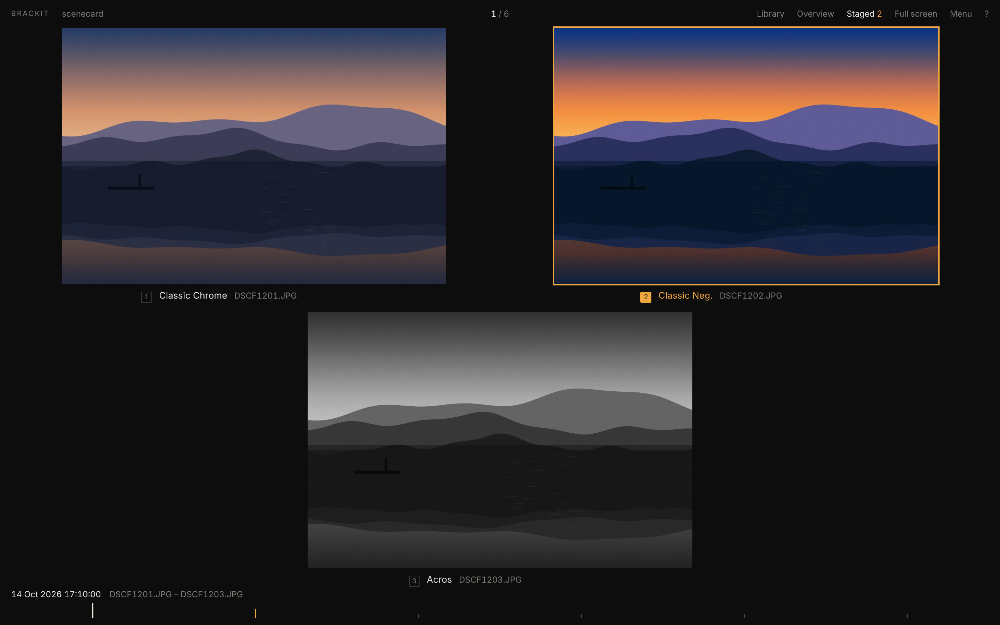

# Brackit

I shoot a Fujifilm camera in **film simulation bracketing** mode. Every press
of the shutter gives me three JPEGs of the same frame, say Classic Chrome,
Classic Neg. and Reala Ace, and then I'd sit in Finder flipping between three
nearly identical files trying to decide which one I liked. Slowly. For
hundreds of photos.

Brackit fixes that one workflow. It finds the three looks of each shot on the
SD card, shows them side by side with the simulation's name under each, and
you press `1`, `2` or `3` to keep the one you want. Then it copies just those
off the card.

It's made for the keyboard. Every step, from choosing the card to ejecting it,
is a key, so you can go through a few hundred shots without reaching for the
mouse. Every button in the app shows its key, and `?` lists them all.

I made it for myself, but if you use film simulation bracketing too, it's
probably useful to you as well.

**[Website](https://lawrenceleejr.github.io/Brackit/)** ·
**[Download](https://github.com/lawrenceleejr/Brackit/releases/latest)**



## What it does

- **Keyboard first.** Arrows to flip, `1` `2` `3` to pick, `Space` to look
  closely, `E` to export. The start screen, the date chooser, the crop tool,
  the picks, the library and the menu all work from the keys too.
- **Brackets side by side.** Each shutter press is one set of three looks, in
  a row or two-over-one, whichever shows them bigger. The film simulation is
  read from the camera's own metadata.
- **Fast flipping.** Arrow keys move between sets with no waiting. Every
  Fujifilm JPEG carries a small thumbnail and a screen-sized preview inside
  it; Brackit shows those and only opens the full file when you look closely.
- **Pick and export.** `1` `2` `3` picks a look (`⌘`/`Ctrl` + number to keep
  more than one). `E` copies everything you picked to a folder, untouched.
  Optionally the RAW (`.RAF`) too.
- **Look closely.** `Space` shows a look full screen. There's a loupe (`` ` ``),
  actual pixels (`Z`), a histogram (`H`), clipping warnings (`J`), the focus
  point and detected faces as the camera recorded them (`A`), and the camera
  settings and film recipe (`I`), with every tag the camera wrote one click
  away.
- **Straighten and crop** (`C`) before export. The card is never changed;
  the crop is applied to the exported copy, with the camera data kept.
- **Library** (`L`) of your export folder: browse by folder and day, rate
  0–5 stars, flag (`P`), filter, and see each photo's recipe.
- **Card housekeeping.** Open just a folder or a range of days (or "new since
  last import"), delete the looks you didn't pick, and eject the card.
- Videos from the card show up too and can be exported.

## Install

Get the latest version from the
**[releases page](https://github.com/lawrenceleejr/Brackit/releases/latest)**.
It's a small download (a few MB).

| | Download | First launch |
|---|---|---|
| **macOS** (Apple silicon) | `Brackit-macOS-AppleSilicon.dmg` | Right-click Brackit → **Open** → **Open**. If macOS says it's damaged, run `xattr -cr /Applications/Brackit.app` once. |
| **macOS** (Intel) | `Brackit-macOS-Intel.dmg` | Same as above. |
| **Windows** | `Brackit-Windows-Setup.exe` | If SmartScreen appears: **More info** → **Run anyway**. |
| **Linux** | `Brackit-Linux.AppImage` | `chmod +x Brackit-Linux.AppImage`, then run it. |

Brackit isn't signed by Apple or Microsoft yet, which is why the first launch
needs that extra step.

### Without the app window

The same program runs from a terminal and opens in your web browser:

```bash
brackit --serve /path/to/your/card
```

On macOS the program is inside the app:
`/Applications/Brackit.app/Contents/MacOS/brackit`. There are also small
standalone `brackit-cli-…` binaries for each system on the releases page.

## How to use it

1. **Put the SD card in** and open Brackit. Press the card's number (or `O`
   to choose any folder).
2. **Choose what to look at.** Brackit shows the card's folders and a chart of
   how many shots you took each day. If you've imported from this card
   before, *New since last import* is already selected, so just press `Enter`.
3. **Flip with ← →** and **pick with 1, 2 or 3.** Your pick gets an orange
   outline.
4. **Press `Space`** to see your pick full screen at full resolution;
   `1` `2` `3` switch looks there.
5. **Press `E`** to export everything you picked. Afterwards Brackit can
   delete the looks you didn't pick from the card, and eject it (`⌘E` /
   `Ctrl+E`).

Your picks, crops, ratings and flags are remembered (in `~/.brackit/`), so you
can eject the card and carry on later.

## Keys

| Key | |
|---|---|
| `←` `→` | previous / next set (`Shift` jumps 10) |
| `1` `2` `3` | pick that look; `⌘`/`Ctrl` + number adds or removes a look |
| `0` | unpick this set |
| `Space` | inspect the pick full screen; `↑` `↓` or `1` `2` `3` switch looks |
| `Z` | actual pixels |
| `` ` `` | loupe (scroll to zoom) |
| `H` | histogram |
| `J` | clipping: red = blown highlights, blue = crushed shadows |
| `A` | annotations: focus point and faces |
| `I` | camera settings, film recipe, all metadata |
| `C` | straighten and crop: `[` `]` straighten, arrows move, `−` `+` resize, `1`–`6` aspect, `Enter` done |
| `G` | overview of every set |
| `S` / `E` | show picks / export picks; in picks `R` adds RAW, `D` changes the folder, `X` clears unpicked looks after export |
| `L` | library of the export folder; there `0`–`5` stars, `P` flag, `⇧1`–`5` / `⇧P` / `T` / `[` `]` filter |
| `⌘⌫` / `Ctrl+Backspace` | delete this set from the card (undo for 10 s with `⌘Z` / `Ctrl+Z`) |
| `O` | choose another folder, dates or card; there `←` `→` choose a day (`⇧` widens), `[` `]` a folder, `Enter` opens |
| `M` | the menu (`↑` `↓` `Enter`) |
| `⌘E` / `Ctrl+E` | eject the card |
| `F` | full screen |
| `?` | all keys |

Every tool is also in the **Menu** (top right) and, on macOS, the menu bar.

## Good to know

- **Nothing on the card is changed** unless you delete something, and deletes
  can be undone for 10 seconds.
- **Exports are exact copies.** Only cropped photos are re-encoded (at JPEG
  quality 95, keeping the camera's metadata and film simulation).
- **The film recipe readout** uses the community's decoding of Fujifilm's
  metadata (the same as exiftool). If something reads wrong for your camera,
  please open an issue.
- **Nothing leaves your computer.** There's no account, no upload, no
  tracking.

## For developers

A small Rust program (`src-tauri/`) reads the card and serves a plain
HTML/CSS/JS interface (`web/`), shown in a [Tauri](https://tauri.app) window
(the system's own web view, which is why the app is small). Without the
window it's the terminal version. The website is in `site/` (Hugo).

```bash
npm install
npm run app          # the app
npm start            # the browser version
npm run build:cli && npm test && npm run test:ui
```

`test:ui` checks that flipping stays under 50 ms per key press. See
`CLAUDE.md` for notes on working on the code. Pushing a tag like `v0.1.0`
builds every platform and publishes a release.
